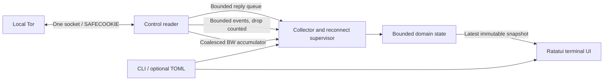

# Architecture

## Boundaries and data flow

- `protocol`: bounded CRLF and dot-stuffed data framing; asynchronous events,
  allowlisted command encoding, a single dedicated reader task and command deadlines.
- `auth`: Tor quoted paths, bounded cookie reads, SAFECOOKIE cryptography.
- `config`: explicit TOML loading, CLI overrides and numeric loopback validation.
- `collector`: transport selection, authentication, subscriptions, queries,
  availability, periodic refresh, connection lifecycle and reconnects.
- `model`: bounded history, metrics, rate calculations, descriptor/consensus parsing,
  OR rows, terminal-control filtering and unit conversion.
- `history`: bounded minute aggregates for the 1h/24h windows, with monotonic
  timestamps, partial buckets and no fabricated missing traffic.
- `resources`: read-only Linux process sampling on a blocking worker. PID/start
  time checks prevent CPU deltas across process replacement; `/proc` failures are N/A.
- `ui`: presentation and keyboard input only. It has no connection or command API.
- `ui/charts`: elapsed-time bucketing and bounded full-width graph rendering;
  missing intervals remain distinct from received zeros.
- `ui/filters`: session-local text/severity filtering, consecutive log grouping
  before filtering, and deterministic cached-key sorting of retained OR rows.
- `preferences`: validates and atomically saves only graph height and time window
  in a separate per-user display file, on an explicit interactive adjustment.
- `app`: shared diagnostics/TUI startup, shutdown notification and task joining.
- `main` and `bin/trm`: thin compatibility/primary command entry points; both
  call the same application lifecycle. No service or installer runs implicitly.

No plugin framework, generic source hierarchy, database, or remote API is needed.

## Repository automation

CI tests the declared minimum Rust version and stable, lint/build checks, release
archive boundaries and a private offline Tor child. Security automation checks
Cargo.lock against RustSec; Dependabot proposes Cargo/Actions updates. Workflow
tokens are read-only and external actions are pinned to full commits. The manual
release workflow builds in Debian 12 and uploads assets for maintainer review;
it never publishes a release or changes a relay. Python packaging uses an explicit
source-root allowlist, includes `.github` and policy files, rejects source symlinks
and verifies hashes, archive paths, executable modes and installation independence.
These scripts are distribution tooling and are not part of the running monitor.
Public interfaces exist to allow scripted-peer integration tests; the binary has
no simulation mode or fallback mock source.

## Concurrency, bounds and backpressure

Tokio uses one asynchronous runtime thread. A session has one reader task and one
collector task; the terminal runs independently. Tokio offloads filesystem calls
internally. One control connection suffices because only one command is outstanding.
The reader never waits for the UI. Replies and events cannot be mistaken for each
other. Cancellation never abandons a partial frame on a connection that will be
reused: a command timeout or shutdown closes that whole session.

| Resource | Bound / policy |
| --- | --- |
| Control wire line | 16 KiB including CRLF; larger input ends the session |
| Complete message | 2 MiB including framing; larger input ends the session |
| Outstanding reply queue | 1; reader awaits capacity; command deadline closes a stalled session |
| Non-BW events | 256 entries; entries with >4096 body bytes or a full queue are dropped and counted |
| BW delivery | A watch slot with cumulative sample count/read/write sums; no event queue |
| History | At most 120 samples and approximately 120 seconds of received BW intervals |
| Long history | At most 1,441 minute buckets covering approximately 24 hours; partial minutes retained |
| Logs | 500 entries, 2048 characters per message; no disk sink |
| OR rows | 2048 retained, peer 256/status 64 characters; total/CONNECTED counts cover the entire response |
| Metrics | Fixed query set; no complete descriptors or OR snapshots retained as metric strings |
| UI delivery | Latest `Arc<State>` watch snapshot, replaces obsolete snapshots |
| Pause | One additional immutable snapshot; no queued display backlog |
| Search | At most 128 Unicode characters per page; no regex engine or persisted queries |
| Process resources | 5-second sampling; 64 KiB/file; at most 1,048,576 descriptor entries; one blocking job at a time |

At 250 ms intervals the collector drains the bounded event queue, computes BW
deltas and publishes a snapshot. If several BW events arrive between observations,
their bytes and interval counts are summed and displayed as one weighted average.
Coalesced intervals are counted, not presented as separate observed instantaneous
points. The mean is weighted by their interval count. A single delayed aggregate
can span more than the nominal 120-second window; it remains explicitly an
aggregate. BW counters saturate at `u64::MAX` to avoid arithmetic overflow; this
extreme lifetime condition is not a promise of unlimited-precision accounting.

Full metric refreshes run every configured poll interval (15 seconds by default).
Queries are sequential and publish incremental snapshots. The reader continues to
accumulate BW and enqueue logs during refresh. A slow Tor can delay collector
publication up to command deadlines while the UI remains responsive; intervening
BW intervals are coalesced. There is no busy poll for BW. Unknown events are
ignored by the model; invalid BW and malformed OR rows increment counters.

## Availability and lifecycle

551/552 and unsupported-query errors become N/A with a reason. Framing, transport,
authentication, unexpected status and deadline errors close the session and remain
visible in the status and in-memory diagnostics. Missing descriptor fields are
never inferred from configured limits or traffic. Invalid numeric metrics become
N/A. Previously received metrics remain visible as a stale snapshot on disconnect.
Rates become N/A after three seconds without a BW sample or upon disconnect.
Graph averages use the selected short window, 1h or 24h. X coordinates cover actual
elapsed time across the entire plot; delayed groups remain weighted averages.
Adjacent nominal BW intervals are aligned when receipt/collection jitter is at
most 500 ms, preventing narrow false gaps at large graph widths. Larger
interruptions remain missing. Zero-height bars draw no baseline dots; the model
still distinguishes received zeros from absent samples and stale rates remain N/A.
The long views sum bytes and observed interval counts into minute buckets. Empty
minutes remain absent; gaps inside a minute cannot be resolved at this resolution.
Jitter alignment never accumulates drift or creates overlapping buckets. The oldest
minute may straddle the 24h boundary; plotting and averages clip to the selected
window. History is local to this monitor invocation and is never backfilled.

Resources are read from the PID reported by Tor. CPU is user+system tick delta
over monotonic elapsed time and `_SC_CLK_TCK`; RSS uses `_SC_PAGESIZE`. Descriptor
usage counts `/proc/PID/fd` entries and the denominator is the soft limit from
`/proc/PID/limits`. Start time is checked before/after sampling; CPU needs two
samples from the same process. Partial availability is retained with a reason.
Resources expire after ten seconds and on disconnect; PID changes invalidate them.
The dashboard omits the complete FD field unless both usage and limit are fresh
and available. Zero usage remains visible. CPU/RAM rendering and graph preferences
are independent; diagnostics retain missing-value reasons. No elevation is requested.
The worker never changes process permissions or reads socket endpoints/traffic.
The monitor must share Tor's PID namespace; no host/container PID translation is
attempted. Process start-time checks detect reuse between local samples.

Pause holds the current Arc and monotonic/wall-clock timestamps in the UI. Graphs,
uptime, countdowns and snapshot ages all use those frozen clocks. The collector
does not receive pause state and keeps draining events, sampling and reconnecting.
Resume drops the frozen Arc and draws the latest watch value.
Timed terminal redraws are suppressed during pause; user input and resize
still redraw the frozen data. Window/dropped/malformed counters have their own
row below `Tor process usage`; resource RAM uses GiB to two decimal places.
In compact layouts the OR count moves beside process totals to preserve graph space.
Search editing takes precedence over ordinary shortcuts; Enter commits, Esc
cancels and Ctrl-C exits.
Logs group consecutive equal level/message runs before filtering, so hidden rows
cannot combine independent runs. Counts refer only to the retained 500 entries.
Accounting counters and quota are queried read-only. The reset countdown parses
Tor's UTC interval end using the `time` crate, and is unavailable on disconnect.
The accounting interval is not assumed to be a calendar day. Its configured rule
(`max`, `sum`, `in`, `out`) is shown rather than inferring per-direction quotas.

Reconnect uses the configured delay, exponential backoff up to 30 seconds for
unsuccessful connections, and resets after an authenticated session. A new session
clears relay identity, cached process counters, resource samples and short graph
history; bounded logs, minute history and monitor-run BW byte sums remain.
Received bytes are drained once more
when a control session ends so events between UI ticks are accounted for.
Cookie
authentication runs again so Tor restarts and cookie rotation are handled.
Shutdown cancels the whole session, aborts its reader on drop, and joins the
collector. It does not wait for a reconnect sleep or a command deadline.

The header queries Tor's own IPv4/IPv6 guesses and version recommendation status.
Address values are parsed and checked for the requested family; unspecified or
malformed values become `not detected`. Recommendation badges distinguish
recommended, nonrecommended, newer and unknown status without a package feed or
third-party request. All available consensus flags remain visible across wrapped
header rows; a fixed allowlist does not filter future flags.
Flag punctuation has its own neutral style. Advertised IPv4/IPv6 OR ports are
parsed from the own descriptor's router/or-address lines or the consensus's
r/a lines, with descriptor priority. Configured listeners are not treated as
proof of an externally published port.

Terminal raw mode and the alternate screen have an RAII guard, with a panic hook
for restoration before printing panic diagnostics. Ctrl-C, EOF and SIGTERM exit
normally. No code can restore a terminal after SIGKILL.

## Security decisions

TCP accepts only numeric loopback socket addresses and never resolves a hostname.
No endpoint is created or exposed. SAFECOOKIE is mandatory. Legacy COOKIE can
disclose file contents to an impersonating server; it is intentionally absent.
The peer HMAC is verified in constant time before sending the controller HMAC.
Cookie contents, client nonce, encoded proof and outgoing command buffers use
zeroizing containers. This limits retained application copies; it is not a claim
that all compiler, crypto-library or OS copies can be erased.

Cookie reads are limited to 33 bytes and accept exactly 32. On Unix, O_NOFOLLOW
rejects symlinks, O_NONBLOCK prevents a malicious FIFO from blocking open, and
metadata rejects non-regular/world-readable files. Local administrators must still
protect their account and socket directories. No privilege elevation occurs.

The wire command enum supports PROTOCOLINFO, AUTHCHALLENGE SAFECOOKIE,
AUTHENTICATE, GETINFO, GETCONF and SETEVENTS only. SETEVENTS changes this
connection's subscriptions, not relay configuration. There is no SETCONF,
SIGNAL, circuit modification, TAKEOWNERSHIP, Tor configuration write, or
service-control code. Display preferences are the sole persistent application
write, contain two validated integers and use a same-directory temporary file
and atomic rename. No Tor configuration file is written. Reply diagnostics contain status codes rather than raw
authentication responses. Tor labels/logs have control characters stripped before
terminal rendering. Logs stay in memory.

## Dependency decisions

Ratatui 0.30 and Crossterm 0.29 supply maintained differential terminal rendering
and asynchronous input. Tokio 1 uses only the required runtime, I/O, networking,
filesystem, synchronization, signal and time features. Serde/TOML implement the
optional small configuration file. Anyhow carries contextual errors. RustCrypto
HMAC 0.12/SHA-256 0.10 are a compatible established pair; newer breaking versions
exist and are not required for this limited use. `getrandom` supplies OS entropy,
`hex` encodes protocol fields, `zeroize` clears owned secret buffers, and Unix
`libc` supplies file-open flags. `futures-util` adapts the Crossterm stream.
`time` parses official UTC accounting timestamps. `tempfile` is test-only.
No tracing subscriber or persistent log dependency is
needed because bounded in-memory diagnostics are sufficient for this MVP.

Review library adoption again before expanding the supported protocol. See
[RESEARCH.md](RESEARCH.md) for the reason a limited local parser was selected.
